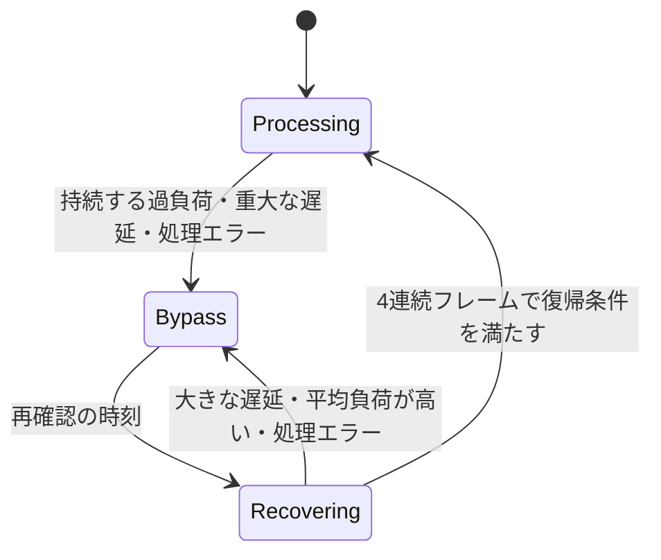

# リアルタイム処理の性能監視と復帰

## 修正対象

以前のWorkletは、512サンプルの時間予算（48 kHzでは約10.67 ms）を少しでも超える処理が5回続くと、自動バイパスに入っていました。約53 msの短い負荷変動でも切り替わり、1 ms単位の時計で「11 ms」と記録される環境でも判定が過敏になります。

バイパス中は16フレームごとに1回だけ処理していたため、3回の成功に最短でも約512 msかかっていました。確認フレームだけ処理音を出すこと、未処理音の経路にSTFTの遅延がないこと、飛び飛びの入力でRNN・STFTの状態を更新することも、音の切り替わりと復帰時の不整合の原因でした。

## 判定方針

時間予算は、左右を合わせた1フレーム全体に適用します。ステレオの各チャンネルに別々の予算を与えたり、モデルごとに監視を無効にしたりはしません。Base・SmallのCPU負荷が高いことは、短い揺れと持続的な処理不足を区別する制御で扱います。

通常時は約200 msの移動窓を使い、次の条件を組み合わせます。

- 平均処理時間が予算の110%を超えていること。
- 窓内の70%以上が予算の105%を超えていること、または平均の超過がさらに1窓分続いていること。
- 超過分から余裕のあるフレームの時間を差し引いた推定不足が、3フレーム分以上蓄積していること。
- 現在のフレームも遅いこと。既に負荷が解消した後に、過去の一時停止だけを理由に切り替えません。

これにより、境界付近の計測の揺れ、単発の大きな停止、短い中程度の負荷変動を吸収します。同時に、速いフレームが途中に挟まっても、平均が長く高ければ保護できます。処理時間が予算の2倍以上となるフレームが3回続く場合は、通常の窓を待たずに保護します。

バックグラウンドでは確認窓を約800 msにし、重大な遅延の連続回数も12回に広げます。前景へ戻る際は古い負荷の証拠を捨て、保護中なら次のフレームで再確認します。

この判定は処理時間からの推定です。ブラウザのデバイスバッファの残量や実際の音切れを直接測定できるわけではありません。平均110%・復帰105%は、計測の揺れを許容し、境界での往復を減らす既定の制御値です。永久に大きな過負荷を許容する設計にはしません。

## 復帰と音声の連続性

初回は32 ms後に再確認します。失敗すると64 ms、128 msと間隔を広げ、128 msで止めます。成功の可能性がある場合は、間を空けずに連続フレームを処理します。4フレームの平均が予算の105%以下なら復帰します。累積処理時間が4フレーム分の許容時間を既に超えた場合は、その時点で再確認を打ち切ります。最初の1回だけ遅くても、後続が速ければ平均で復帰できるため、冷えたモデルやキャッシュの確認を毎回やり直す状態を避けます。

再確認を始める際には両チャンネルのエンジンをリセットします。確認中は連続した現在の入力でSTFT・RNNの状態を戻し、出力は未処理音のままにします。合格した後だけ、1フレームにわたる共通のクロスフェードで処理音へ戻します。単発の確認音や初期化直後のゼロ出力は流しません。

負荷が下がってから連続確認に合格するまでの目安は、初回で約64 ms、最大バックオフでも約160 msです。これらは48 kHzの音声フレーム基準であり、OSの停止やブラウザのスケジュール遅延を含む実時間の保証ではありません。

未処理音には `nFft - hopSize` の遅延を付け、処理音と同じ時間位置にそろえます。現行モデルでは512サンプルです。以前の手動バイパスと比べると約10.67 msの遅延が増えますが、切り替えで時間位置が飛ぶことを防ぎます。フレーム組み立ての384サンプルと合わせたWorklet内の信号遅延は896サンプルです。デバイスやMediaStream経路の遅延は別に加わります。

手動バイパス中は推論を止め、自動保護の履歴を解除します。解除時は状態をリセットして2フレームを未処理音で流し、その後に処理音へ移します。停止・破棄したReactセッションから届く保護通知は無視します。

## 時計と統計

`performance.now()` はコールバック間で進んでも、コールバックの内部で止まっている場合があります。処理区間の差を確認し、差が取れない場合は `Date.now()` を使います。逆行・非有限値・時計が利用できない場合は、過負荷や復帰成功の証拠に使いません。音声クロック `currentTime` の区間差をCPU処理時間として扱いません。

`getWorkletState()` は追加の診断値を返します。既存のセルフホストWorkletとの互換性のため、型では追加値を省略可能にしています。

| 値 | 意味 |
|----|------|
| `performanceMode` | `processing` / `bypass` / `recovering` / `manual` |
| `averageProcessingMs` | 現在の負荷窓、または連続復帰確認の平均 |
| `budgetMs` | チャンネル全体の1フレームの時間予算 |
| `timingSource` | `performance` / `date` / `unavailable` |
| `audioFrames` | 未処理音を流したフレームも含めた入力フレーム数 |
| `passthroughFrames` | 全体を未処理音で出したフレーム数 |

Workletの統計の `overBudgetFrames` と `overBudgetRate` は、計測した処理時間が予算を超えた数と割合です。デバイスで実際に欠落した音声フレーム数ではありません。古い `droppedFrames` と `dropRate` は同じ値の互換用名称として残します。従来の `frameCount` は実行した推論数、`totalFrames` は最大2000件の計測窓の件数です。保護中でも定期統計を送ります。

フレームAPIの `denoiser.performance.droppedFrames` は、従来どおり処理例外の累計です。Worklet統計の互換用の同名フィールドとは意味が異なります。

Stream APIの `autoPassthrough` と `onAutoBypass` は、保護・復帰確認中を表します。React hookにも `onAutoBypass` を追加し、React・ストリームのデモで一時停止を表示します。手動の `bypass` 設定とは区別します。

## 検証

- 単体テストは、別の簡略版スケジューラーを試す方式を廃止し、配布する `processor.js` の実際の `process()` を仮想時計で動かします。
- 小さな連続超過、85 msの負荷変動、単発の大きな停止、平均負荷の低い／高い交互パターン、ステレオの合計負荷、バックグラウンド復帰、時計の異常、エンジンの例外を検証します。
- 未処理音と処理音の遅延、確認音の混入防止、左右共通のクロスフェード、手動切り替え、Reactセッションの古い通知を検証します。
- ChromiumではBase・Smallのscalar/SIMD、ステレオの実WASMを使い、計測時間だけを制御して負荷変動と復帰を再現します。復帰後の出力は、新しくリセットした独立したモノラルエンジンと比較します。この試験は実機の音切れを測る試験とは区別します。
- 実際の処理速度は、計測時間を差し替えないブラウザの性能試験で別途確認します。Firefox・Safariの今回の制御変更は未検証です。

エンジンのCコード・モデル重み・オフライン処理の推論方法は変更していません。Workletの制御と出力経路を見直し、埋め込み・セルフホスト・デモの各配布形態に同じ変更を反映します。
