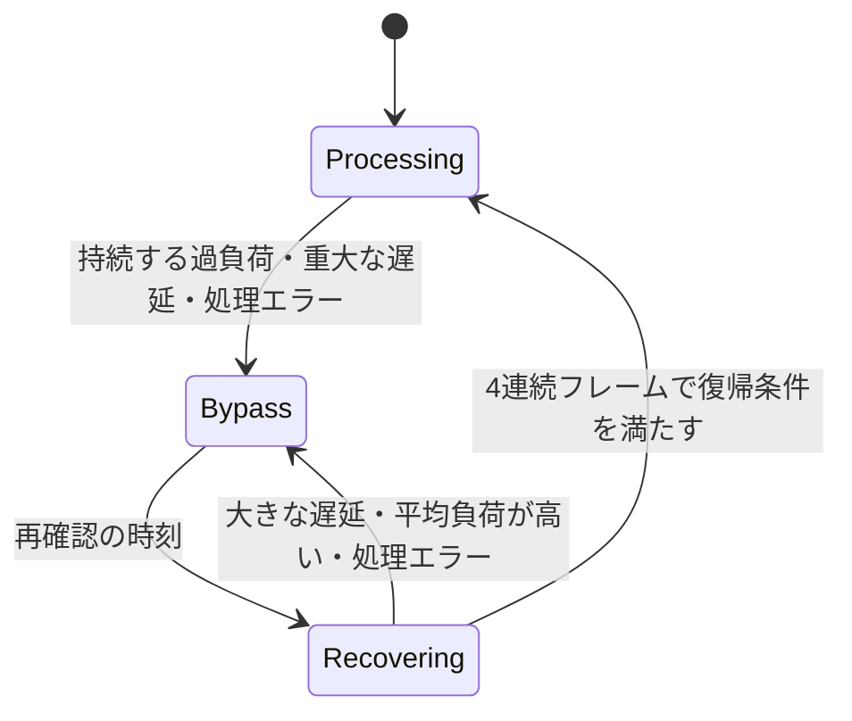

# リアルタイム処理の性能監視と復帰

## 修正対象

以前のWorkletは、512サンプルの時間予算（48 kHzでは約10.67 ms）を少しでも超える処理が5回続くと、自動バイパスに入っていました。約53 msの短い負荷変動でも切り替わり、1 ms単位の時計で「11 ms」と記録される環境でも判定が過敏になります。

バイパス中は16フレームごとに1回だけ処理していたため、3回の成功に最短でも約512 msかかっていました。確認フレームだけ処理音を出すこと、未処理音の経路にSTFTの遅延がないこと、飛び飛びの入力でRNN・STFTの状態を更新することも、音の切り替わりと復帰時の不整合の原因でした。

その後、SmallでフレームAPIは動作するのに上位のストリーム・React APIがバイパスする報告を受け、次の条件を配布するWorkletで再現し、追加修正しました。

- デモのサンプルWAVは1チャンネルですが、`createMediaStreamDestination()` の既定値が2だったため、ストリーム・Reactのデモでは2つのエンジンが動作していました。フレームのデモは1チャンネル処理です。サンプルから作るMediaStreamのチャンネル数を元のAudioBufferに合わせ、上位デモが既知の入力チャンネル数を明示することで、不要な2倍の推論を防ぎました。生成直後のトラック設定がまだ2を返す場合にも、設定反映のタイミングに依存しません。ライブラリの本物のステレオ入力の処理は維持します。
- 通常の停止基準が110%超なのに復帰は105%以下だったため、108%の負荷は一度停止すると戻れませんでした。
- 復帰時のリセット時間と冷えた初期フレームを短い推論確認に含め、毎回確認を失敗させることがありました。
- 粗い `performance.now()` で正の値が出た場合はそれを採用し、ゼロのときだけ `Date.now()` を採用していました。この時計の混用は平均を上振れさせます。16 ms刻みの時計と8 msの推論で、不要な停止・復帰の繰り返しを再現しました。
- 320 msの一時的な130%負荷だけで停止し、その直後に復帰していました。

## 判定方針

フレームと上位APIの違いは、デモでは次のとおりです。

| 比較項目 | フレームのデモ | ストリーム・Reactのデモ |
|---|---|---|
| 実行場所 | メインスレッドのScriptProcessor | AudioWorklet |
| 入力の組み立て | 512サンプルを直接処理 | 128サンプルずつ受け、512サンプルにまとめる |
| モノラルサンプルの推論回数 | 1回 | 修正前は2回、修正後は1回 |
| 自動バイパス | なし | 共通のWorklet監視で判定 |
| 時間計測 | メインスレッドのperformance時計 | Worklet内の時計。凍結・粗い刻みではDateを使用 |

モデル重みと推論用WASMは同じです。フレーム側で問題がないことだけでは、上位が同じチャンネル数・計測条件で実行されているとは限りません。

時間予算は、左右を合わせた1フレーム全体に適用します。ステレオの各チャンネルに別々の予算を与えたり、モデルごとに監視を無効にしたりはしません。Base・SmallのCPU負荷が高いことは、短い揺れと持続的な処理不足を区別する制御で扱います。

通常時は約200 msの移動窓を使い、次の条件を組み合わせます。

- 平均処理時間が予算の110%を超えていること。
- 軽度の平均超過が約1秒続くこと。または、平均が予算の150%以上で、窓内の70%以上が予算の105%を超えていること。
- 超過分から余裕のあるフレームの時間を差し引いた推定不足が、3フレーム分以上蓄積していること。
- 現在のフレームも遅いこと。既に負荷が解消した後に、過去の一時停止だけを理由に切り替えません。

これにより、境界付近の計測の揺れ、単発の大きな停止、短い中程度の負荷変動を吸収します。同時に、速いフレームが途中に挟まっても、平均が長く高ければ保護できます。処理時間が予算の2倍以上となるフレームが3回続く場合は、通常の窓を待たずに保護します。

バックグラウンドでは移動窓を約800 ms、軽度の超過の継続確認を約4秒とし、重大な遅延の連続回数も12回に広げます。前景へ戻る際は古い負荷の証拠を捨て、保護中なら次のフレームで再確認します。

この判定は処理時間からの推定です。ブラウザのデバイスバッファの残量や実際の音切れを直接測定できるわけではありません。平均110%は計測の揺れを許容する既定の制御値で、通常時と復帰時で共通にしました。軽度の超過は移動窓が満たされてから約1秒の継続を確認するため、一定負荷の停止まで約1.2秒かかります。実際に110%の負荷を永久に処理できるという保証ではなく、一時変動を許容する制御です。

## 復帰と音声の連続性

初回は32 ms後に再確認します。失敗すると64 ms、128 msと間隔を広げ、128 msで止めます。間を空けずに2フレームの入力で状態・キャッシュを温め、その後の4フレームの平均が予算の110%以下なら復帰します。計測する4フレームの累積処理時間が許容時間を超え、丸め誤差の範囲よりも大きい負荷なら、その時点で再確認を打ち切ります。温める区間も含めて予算の2倍以上が3回続けば、早く確認を打ち切ります。リセットは一度だけ発生する準備なので、持続する推論負荷の計測には含めません。準備中の処理例外には従来どおり保護を適用します。

Dateの1 ms単位の丸めで4件の平均が基準を少し超えた場合は、リセットしてやり直す代わりに、計測を最大12フレームまで続けます。超過が1 ms以内の確認だけが対象で、復帰基準の110%は変更しません。12件でも満たせなければ打ち切り、明確に大きい負荷は従来どおり早く確認を終了します。

再確認を始める際には両チャンネルのエンジンをリセットします。確認中は連続した現在の入力でSTFT・RNNの状態を戻し、出力は未処理音のままにします。合格した後だけ、1フレームにわたる共通のクロスフェードで処理音へ戻します。単発の確認音や初期化直後のゼロ出力は流しません。

負荷が下がってから連続確認に合格するまでの目安は、初回で約85 ms、最大バックオフでも約180 msです。丸めで確認を延長した場合は、最大バックオフと合わせて約270 msまで延びます。これらは48 kHzの音声フレーム基準であり、OSの停止やブラウザのスケジュール遅延を含む実時間の保証ではありません。

未処理音には `nFft - hopSize` の遅延を付け、処理音と同じ時間位置にそろえます。現行モデルでは512サンプルです。以前の手動バイパスと比べると約10.67 msの遅延が増えますが、切り替えで時間位置が飛ぶことを防ぎます。フレーム組み立ての384サンプルと合わせたWorklet内の信号遅延は896サンプルです。デバイスやMediaStream経路の遅延は別に加わります。

手動バイパス中は推論を止め、自動保護の履歴を解除します。解除時は状態をリセットして2フレームを未処理音で流し、その後に処理音へ移します。停止・破棄したReactセッションから届く保護通知は無視します。

## 時計と統計

`performance.now()` はコールバック間で進んでも、コールバックの内部で止まっている場合があります。`Date.now()` では処理時間が取れるのに `performance.now()` がゼロになる場合は、そのWorkletでは以後 `Date.now()` を使います。両方がゼロの短い処理だけでは時計を固定しません。切り替え時は以前の計測窓を捨て、粗い時計の正の値と別の時計の値を混ぜません。逆行・非有限値・時計が利用できない場合は、過負荷や復帰成功の証拠に使いません。音声クロック `currentTime` の区間差をCPU処理時間として扱いません。

`getWorkletState()` は追加の診断値を返します。既存のセルフホストWorkletとの互換性のため、型では追加値を省略可能にしています。

| 値 | 意味 |
|----|------|
| `performanceMode` | `processing` / `bypass` / `recovering` / `manual` |
| `averageProcessingMs` | 現在の負荷窓、または連続復帰確認の平均 |
| `budgetMs` | チャンネル全体の1フレームの時間予算 |
| `timingSource` | `performance` / `date` / `unavailable` |
| `audioFrames` | 未処理音を流したフレームも含めた入力フレーム数 |
| `passthroughFrames` | 全体を未処理音で出したフレーム数 |

Workletの統計の `overBudgetFrames` と `overBudgetRate` は、計測した処理時間が予算を超えた数と割合です。デバイスで実際に欠落した音声フレーム数ではありません。古い `droppedFrames` と `dropRate` は同じ値の互換用名称として残します。従来の `frameCount` は実行した推論数、`totalFrames` は最大2000件の計測窓の件数です。保護中でも定期統計を送ります。

フレームAPIの `denoiser.performance.droppedFrames` は、従来どおり処理例外の累計です。Worklet統計の互換用の同名フィールドとは意味が異なります。

Stream APIの `autoPassthrough` と `onAutoBypass` は、保護・復帰確認中を表します。React hookにも `onAutoBypass` を追加し、React・ストリームのデモで一時停止を表示します。手動の `bypass` 設定とは区別します。

## 検証

- 単体テストは、別の簡略版スケジューラーを試す方式を廃止し、配布する `processor.js` の実際の `process()` を仮想時計で動かします。
- 小さな連続超過、85 ms・320 msの負荷変動、単発の大きな停止、平均負荷の低い／高い交互パターン、ステレオの合計負荷、バックグラウンド復帰、時計の異常、エンジンの例外を検証します。108%での復帰、高いリセット費用、2つの冷えた初期フレーム、16 ms刻みの時計、Dateの丸めが異なる10の位相も含めます。
- 未処理音と処理音の遅延、確認音の混入防止、左右共通のクロスフェード、手動切り替え、Reactセッションの古い通知を検証します。
- ChromiumではBase・Smallのscalar/SIMD、ステレオの実WASMを使い、計測時間だけを制御した6条件・24件で負荷変動と復帰を再現します。復帰後の出力は、新しくリセットした独立したモノラルエンジンと比較します。粗い時計の試験は区間計測自体を通します。この試験は実機の音切れを測る試験とは区別します。
- 実際の処理速度は、計測時間を差し替えないブラウザの性能試験で別途確認します。Firefox・Safariの今回の制御変更は未検証です。

今回の最終確認では、単体・異常系426件と、Chromiumの選択した43件が通過しました。埋め込み／静的WorkletのSmallストリーム、Base・Smallのscalar/SIMDの性能試験、Tinyを含むステレオの出力一致も確認しています。

本番ビルドのストリーム・Reactデモでは、Smallの4条件ずつ、合計8件を確認しました。条件は実際の時計での処理、105〜110%の範囲での復帰、16 ms刻みの時計、周期的な320 msの130%負荷です。すべてWorkletの初期化が1チャンネルとなり、通常・時計・周期負荷の条件では自動バイパスを起こさず、復帰条件では停止通知を解除しました。スマートフォン相当の画面幅を使いましたが、OS・ブラウザのスマートフォン実機試験ではありません。

エンジンのCコード・モデル重み・オフライン処理の推論方法は変更していません。Workletの制御と出力経路を見直し、埋め込み・セルフホスト・デモの各配布形態に同じ変更を反映します。
